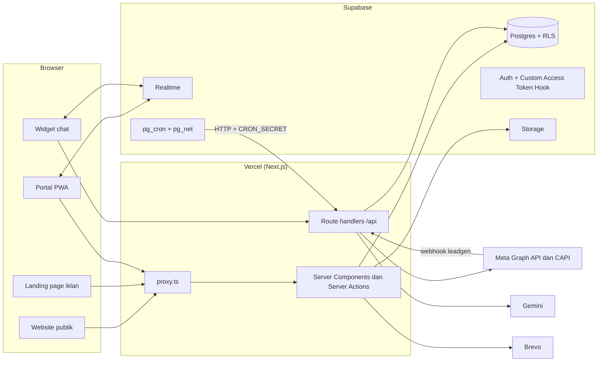
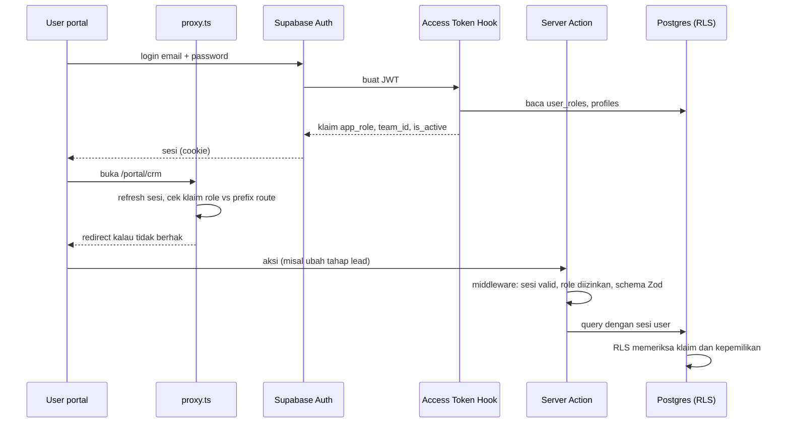
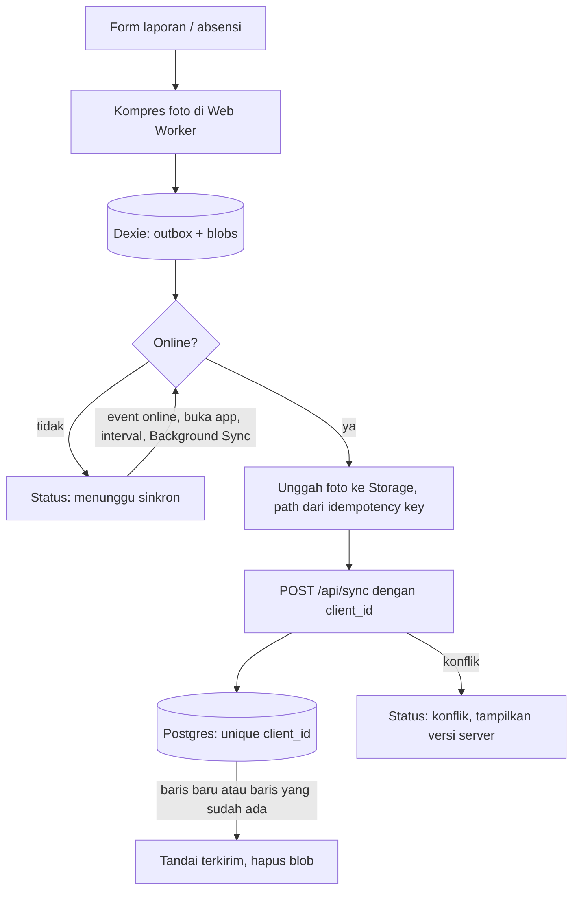
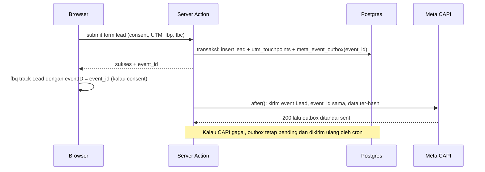
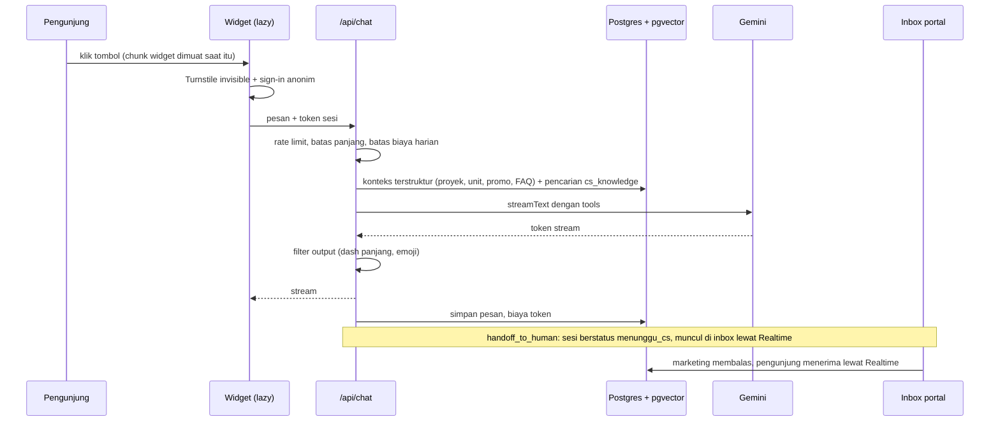

# Arsitektur KIS Group Platform

Disusun di Fase 0. Acuan untuk Fase 1 sampai 9. API library (Next.js, Supabase, Serwist, AI SDK) dicek ulang terhadap versi yang terpasang saat implementasi, bukan dari dokumen ini.

## 1. Gambaran besar

Prinsip:
- Server Component sebagai default. Data publik dibaca di server dan di-cache dengan tag. Data portal dibaca per request dengan sesi user, lalu TanStack Query di client.
- RLS adalah batas keamanan utama. Guard di `proxy.ts` dan server action adalah lapisan tambahan untuk pengalaman pengguna dan pesan error yang jelas.
- Semua penulisan dari client lewat server action `next-safe-action` dengan schema Zod yang sama dengan form. Route handler hanya untuk webhook, cron, chat streaming, beacon event, dan sinkronisasi offline.
- Paket gratis (CLAUDE.md bagian 10): tidak ada Vercel Cron, semua jadwal dari `pg_cron`.

## 2. Peta route

### 2.1 Website publik: `src/app/(site)/`

| Route | Isi | Rendering |
|---|---|---|
| `/` | Hero Banner penuh satu layar tepat di bawah navbar (tinggi `100svh` dikurangi tinggi navbar, foto `priority` dengan `sizes="100vw"`, bisa berisi beberapa slide dari admin), strip statistik, sorotan Sejahtera Green Village, progres pembangunan, berita, promo, CTA | Static, revalidate by tag |
| `/proyek` | Daftar proyek terbit, tanpa filter. Selama hanya ada satu proyek terbit, menu "Proyek" langsung menuju halaman detailnya | Static, revalidate by tag |
| `/proyek/[slug]` | Galeri, tipe unit, siteplan, fasilitas, lokasi, progres, form minat | Static per slug (`generateStaticParams`), revalidate by tag. Status kavling siteplan di-hydrate dari Realtime |
| `/proyek/[slug]/progres` | Progres pembangunan yang disetujui | Static, revalidate by tag |
| `/simulasi-kpr` | Simulasi KPR konvensional (fixed lalu floating) dan syariah (murabahah margin flat), semua angka bisa diubah, logo bank rekanan. Versi pertama sudah tampil di beranda sejak Fase 1 | Static, hitung di client. Nilai awal dari `src/config/kpr.ts`, Fase 4 dari admin |
| `/tentang` | Profil, visi misi, legalitas, perjalanan proyek | Static |
| `/berita`, `/berita/[slug]` | Berita | Static, revalidate by tag |
| `/promo`, `/promo/[slug]` | Promo aktif dan detail | Static, revalidate by tag dan saat masa berlaku habis |
| `/karir`, `/karir/[slug]` | Lowongan + form lamaran | Static, form via server action |
| `/kontak` | Alamat, peta, form kontak, WhatsApp | Static |
| `/kebijakan-privasi`, `/syarat-ketentuan` | Halaman legal | Static |
| `/sitemap.xml`, `/robots.txt`, `opengraph-image` | SEO | Static, revalidate by tag |

`not-found.tsx` untuk slug yang tidak ada. Setiap segmen punya `loading.tsx` dan `error.tsx`.

### 2.2 Landing page: `src/app/(landing)/lp/`

| Route | Isi | Rendering |
|---|---|---|
| `/lp/[slug]` | Blok dari `landing_page_blocks`, layout tanpa navigasi utama | Static per slug dan per variant |

A/B variant: `proxy.ts` memilih variant berdasarkan bobot traffic, menyimpan cookie `lp_v_[slug]` supaya pengunjung yang sama selalu melihat variant yang sama, lalu rewrite ke `/lp/[slug]/v/[variant]` yang tetap statis. Variant tercatat di `utm_touchpoints` dan di lead.

### 2.3 Portal: `src/app/portal/` (PWA, scope `/portal/`)

| Route | Role | Rendering |
|---|---|---|
| `/portal/login`, `/portal/lupa-password`, `/portal/reset-password`, `/portal/undangan` | Publik | Dynamic |
| `/portal` | Semua staf. Redirect ke beranda sesuai role | Dynamic |
| `/portal/akun` | Semua staf. Profil, ganti password, notifikasi | Dynamic |
| `/portal/offline` | Semua. Halaman fallback service worker | Static, di-precache |
| `/portal/absensi` | site_supervisor, site_manager, marketing, marketing_manager | Dynamic, bisa offline |
| `/portal/lapangan/laporan`, `/baru`, `/[id]` | site_supervisor (proyek yang ditugaskan), site_manager | Dynamic, bisa offline |
| `/portal/lapangan/isu` | site_supervisor, site_manager | Dynamic |
| `/portal/lapangan/persetujuan` | site_manager | Dynamic |
| `/portal/marketing/aktivitas`, `/target`, `/peringkat` | marketing, marketing_manager | Dynamic |
| `/portal/crm/leads` (kanban dan tabel), `/leads/[id]` | marketing (miliknya), marketing_manager (timnya), owner, admin | Dynamic |
| `/portal/crm/jadwal`, `/tugas`, `/booking` | sama dengan di atas | Dynamic |
| `/portal/crm/inbox` | marketing, marketing_manager. Handoff chat | Dynamic + Realtime |
| `/portal/crm/laporan` | marketing_manager, owner, admin | Dynamic |
| `/portal/owner` dan turunannya (`/proyek/[slug]`, `/karyawan/[id]`, `/ekspor`) | owner (admin baca saja) | Dynamic |
| `/portal/admin/...` | owner, admin | Dynamic |

Sub-route admin: `proyek`, `proyek/[id]/unit` (editor siteplan), `konten/berita`, `konten/promo`, `konten/banner`, `konten/testimoni`, `konten/faq`, `karir`, `karir/lamaran`, `landing-pages`, `kampanye`, `pipeline`, `pengguna`, `tim`, `kpi`, `cs/pengetahuan`, `cs/pengaturan`, `cs/transkrip`, `cs/statistik`, `integrasi/meta`, `audit`, `pdp`, `pengaturan`.

Role `finance` aktif sejak awal: akses baca ke `/portal/crm/booking` (deal, booking fee, status berkas) dan laporan penjualan. Tidak bisa mengubah lead atau tahap pipeline.

### 2.4 API: `src/app/api/`

| Route | Metode | Fungsi | Pengaman |
|---|---|---|---|
| `/api/webhooks/meta/leadgen` | GET, POST | Verifikasi dan terima Lead Ads | `hub.verify_token`, `X-Hub-Signature-256`, rate limit |
| `/api/cron/meta-outbox` | POST | Kirim Conversion Leads dan event CAPI yang tertunda | `CRON_SECRET` |
| `/api/cron/meta-webhook-retry` | POST | Proses ulang webhook yang gagal | `CRON_SECRET` |
| `/api/cron/lead-sla` | POST | Eskalasi lead yang belum direspons | `CRON_SECRET` |
| `/api/cron/retention` | POST | Hapus chat dan file yang lewat masa simpan (termasuk objek Storage) | `CRON_SECRET` |
| `/api/chat` | POST | Streaming jawaban widget | Turnstile, sesi anonim, rate limit, batas biaya |
| `/api/events/contact` | POST | Event Contact (klik WhatsApp) untuk CAPI, dikirim dengan `sendBeacon` | Rate limit, consent |
| `/api/sync` | POST | Sinkronisasi antrian offline PWA | Sesi user, idempotency key |
| `/api/health` | GET | Cek hidup untuk smoke test | Publik, tanpa data |

Jadwal `pg_cron` (zona waktu UTC di database, dikonversi dari WIB):

| Job | Jadwal | Cara |
|---|---|---|
| Meta outbox | tiap 5 menit | `pg_net` ke `/api/cron/meta-outbox` |
| Webhook retry | tiap 15 menit | `pg_net` |
| SLA lead | tiap 5 menit | `pg_net` (perlu kirim notifikasi push) |
| Hold unit kedaluwarsa | tiap 5 menit | SQL murni di database |
| Skor KPI | harian 01.00 WIB | SQL murni |
| Retensi data | harian 02.00 WIB | `pg_net` (perlu hapus objek Storage) |

`CRON_SECRET` dan URL app disimpan di Supabase Vault, hanya untuk production. Batch kecil supaya selesai dalam batas durasi fungsi Vercel Hobby.

## 3. Strategi rendering dan cache

| Jenis | Strategi | Invalidasi |
|---|---|---|
| Halaman publik dan LP | Static + cache data dengan tag (`project:[slug]`, `projects`, `posts`, `promos`, `banners`, `lp:[slug]`, `settings`) | Server action admin memanggil `revalidateTag` untuk tag yang terdampak setelah commit DB berhasil |
| Konten terjadwal (promo, berita) | Static | Job retensi/jadwal memanggil revalidate saat jadwal tayang atau masa berlaku tercapai |
| Status unit di siteplan | Nilai awal dari cache statis, pembaruan langsung lewat Supabase Realtime (baca anonim kolom status saja) | Realtime |
| Portal | Dynamic per request, data awal dari Server Component, interaksi lewat TanStack Query | Invalidate query setelah mutasi, plus Realtime untuk CRM dan inbox |
| API | Dynamic | |

Detail API cache (Cache Components / `use cache` / `cacheTag` atau `fetch` tag) dipilih di Fase 1 sesuai versi Next.js yang terpasang.

## 4. Auth dan RBAC

- Tidak ada registrasi publik. Admin mengundang user (email undangan dari notifikasi@kisgroup.co.id lewat SMTP Brevo), user mengatur password di `/portal/undangan`.
- `user_roles`: satu role aktif per user. Penugasan proyek di `project_assignments`, keanggotaan tim di `team_members`.
- Custom Access Token Hook (fungsi Postgres) menyuntikkan `app_role`, `team_id`, `is_active` ke JWT. Penugasan proyek tidak masuk JWT karena bisa berubah kapan saja. RLS memeriksanya lewat fungsi helper.
- Fungsi helper RLS di schema `private` (`security definer`, `stable`): `current_app_role()`, `has_role(roles[])`, `is_active_staff()`, `is_assigned_to_project(project_id)`, `manages_user(user_id)`.
- `proxy.ts`: memperbarui sesi Supabase dan menolak prefix route yang tidak sesuai role (misal `/portal/admin` untuk non owner/admin). Tidak dianggap pengaman utama.
- `next-safe-action`: `actionClient`, lalu `authActionClient` (sesi valid dan staf aktif), lalu `roleActionClient(roles)`. Error dikembalikan sebagai pesan yang bisa ditampilkan, bukan stack trace.
- Menonaktifkan user: `profiles.is_active = false`, sesi dicabut lewat admin API, hook mengisi `is_active=false`, RLS menolak semua akses staf.
- Pengunjung widget chat memakai Supabase Anonymous Sign-In, supaya RLS bisa membatasi tiap pengunjung ke sesi chat miliknya sendiri, termasuk lewat Realtime.

## 5. Unggah gambar

Mengikuti CLAUDE.md bagian 8.
- Modul `src/lib/image/`:
  - `compress.ts`: API publik.
  - `compress.worker.ts`: `createImageBitmap` + `OffscreenCanvas`.
  - `fallback.ts`: canvas di main thread.
- Batas per jenis ada di `src/config/images.ts`.
- Alur:
  1. Pilih file.
  2. Validasi tipe.
  3. Kompres (WebP, fallback JPEG) dan buang EXIF.
  4. Catat metadata yang perlu (waktu, koordinat).
  5. Unggah ke Storage lewat signed upload URL dari server action, atau simpan dulu ke Dexie kalau offline.
  6. Server menyimpan path dan metadata ke tabel.
- Bucket:
  - `public-assets`: publik, konten website.
  - `site-reports`, `attendance`, `customer-docs`, `job-applications`, `avatars`: privat, dibaca lewat signed URL berumur pendek.
  - Semua bucket punya `file_size_limit` dan `allowed_mime_types`.

## 6. Offline PWA

- Dexie database `kis-portal`:
  - `outbox`: `id` (UUID = idempotency key), `kind`, `payload`, `status`, `attempts`, `last_error`, `created_at`.
  - `blobs`: foto terkompresi.
  - `drafts`: form yang belum dikirim.
  - `refdata`: proyek yang ditugaskan, item pekerjaan, data geofence.
- Idempotensi:
  - Setiap baris yang dibuat dari portal punya kolom `client_id uuid unique`. `/api/sync` memakai insert `on conflict (client_id) do nothing` lalu mengembalikan baris yang ada. Kiriman ulang tidak membuat data ganda.
  - Foto disimpan di path `[bucket]/[user_id]/[client_id]/[photo_id].webp` tanpa upsert. Respons "sudah ada" dianggap berhasil, sehingga upload yang putus di tengah bisa diulang dengan aman.
- Pemicu sinkron:
  - event `online`, aplikasi dibuka atau kembali terlihat, dan interval 60 detik selama ada antrian
  - Background Sync API di service worker untuk browser yang mendukung (Chrome Android). iOS tidak mendukung, jadi sinkron terjadi saat aplikasi dibuka.
- Konflik: laporan hanya bisa diubah pembuatnya selama berstatus `draft` atau `dikembalikan`. Kalau server sudah mengubah status (misal disetujui) saat perubahan offline masih antre, server menolak dengan kode konflik. Client menandai item "konflik", menampilkan versi server, dan teks isian user tetap bisa disalin. Server selalu menang.
- Waktu dan lokasi:
  - Absensi menyimpan `captured_at` (jam HP) dan `received_at` (jam server). Selisih lebih dari 10 menit ditandai untuk ditinjau.
  - Geofence dihitung di server dari koordinat dan akurasi GPS.
- Kuota: aplikasi meminta `navigator.storage.persist()` dan menampilkan pemakaian. Foto dikompres sebelum masuk Dexie, sesuai aturan kompresi.
- Service worker:
  - Serwist kalau kompatibel dengan bundler Next yang terpasang. Kalau tidak, service worker manual (dicek di Fase 8).
  - Precache shell portal dan `/portal/offline`.
  - Tidak meng-cache response API yang berisi data pribadi.

## 7. Alur Meta

### 7.1 Pixel + CAPI (dedup)

- Transactional outbox: baris `meta_event_outbox` ditulis dalam transaksi yang sama dengan lead. Submit form tidak pernah gagal karena Meta.
- Consent:
  - Banner cookie mengatur Pixel dan CAPI untuk event penjelajahan (`PageView`, `ViewContent`, `Contact`). Tanpa consent, keduanya tidak dikirim.
  - Event `Lead`, `Schedule`, dan Conversion Leads dikirim berdasarkan persetujuan PDP di form lead. Teks persetujuannya menyebut pemakaian data untuk pengukuran iklan. Tanpa persetujuan PDP, form tidak bisa dikirim.
- `fbp` dari cookie `_fbp`. `fbc` dari cookie `_fbc`, atau dibuat dari `fbclid` (`fb.1.[timestamp ms].[fbclid]`) saat kunjungan pertama dan disimpan sebagai cookie first-party.
- Hash SHA-256 setelah normalisasi: email huruf kecil dan dipangkas, nomor HP E.164 tanpa tanda `+`, `external_id` = id lead.
- Event `Contact` (klik WhatsApp): browser memanggil `fbq` dengan `event_id`, lalu `sendBeacon` ke `/api/events/contact` untuk CAPI.
- Preview deployment selalu menyertakan `test_event_code`.

### 7.2 Webhook Lead Ads

1. GET: cocokkan `hub.verify_token`, kembalikan `hub.challenge`.
2. POST: verifikasi `X-Hub-Signature-256` dari raw body dengan App Secret. Gagal: 401.
3. Simpan payload mentah ke `meta_webhook_events` (unique `leadgen_id`). Duplikat: abaikan, tetap balas 200.
4. Balas 200 secepatnya. Proses di `after()`:
   - ambil detail lead lewat Graph API
   - normalisasi nomor HP
   - gabung dengan lead yang sudah ada (berdasarkan nomor) atau buat lead baru dengan sumber `meta_lead_ads` dan `meta_lead_id`
   - round-robin, lalu notifikasi
5. Gagal: status `failed`, diulang oleh `/api/cron/meta-webhook-retry` dengan backoff.

### 7.3 Conversion Leads (CRM ke Meta)

1. Perubahan tahap lead menulis `lead_stage_history` (trigger).
2. Trigger berikutnya membaca `pipeline_stages.meta_event_name`. Kalau tidak kosong, trigger membuat baris `meta_event_outbox` dengan `event_time` = waktu perubahan tahap.
3. `pg_cron` tiap 5 menit memanggil `/api/cron/meta-outbox`. Worker:
   - mengambil batch dengan `for update skip locked` lewat RPC
   - melewati event yang `event_time`-nya lebih dari 7 hari (status `expired`) atau sebelum lead dibuat
   - mengirim dengan `action_source: "system_generated"`, `custom_data.event_source: "crm"`, `custom_data.lead_event_source: "KIS CRM"`, dan `user_data.lead_id` atau `em`/`ph` ter-hash
4. Retry: `next_attempt_at = now + 2^attempts menit`. Setelah 8 kali gagal: `dead`. Respons Meta disimpan. Admin bisa kirim ulang dari `/portal/admin/integrasi/meta`.

## 8. Widget chat

- Model dari env `GEMINI_MODEL` dan `GEMINI_EMBEDDING_MODEL`. Saat test, env `AI_MOCK=1` memakai mock provider AI SDK.
- Instruksi sistem di file berversi `src/features/chat/prompts/`, bukan di komponen.
- Rate limit memakai tabel Postgres `rate_limits` (tanpa layanan tambahan). Dipakai juga untuk form publik dan webhook.
- Provider gagal atau timeout: widget beralih ke tombol WhatsApp dan form singkat.
- Di luar jam kerja (`cs_settings`): tawarkan WhatsApp dengan ringkasan percakapan di pesan pembuka.

## 9. Lingkungan dan konfigurasi

| Lingkungan | App | Database | Meta |
|---|---|---|---|
| Lokal (laptop) | `pnpm dev` hanya untuk melihat UI publik. Tidak ada E2E dan Supabase lokal | Tidak ada. Portal tidak aktif di laptop | `test_event_code` |
| CI | Production build | Supabase lokal di runner, dibuat baru setiap run lalu dibuang | Di-mock |
| Preview (PR) | Vercel Preview | Tidak ada. Portal tidak aktif, website publik tetap bisa dicek | `test_event_code` |
| Production | `main`, deploy otomatis Vercel. Migrasi lewat `deploy-db.yml` | `skxawyvopumzrefnmvyf` | Live |

Tanpa staging sejak Fase 2 (keputusan owner, mengikuti pola prins dan kelola).

Env divalidasi `@t3-oss/env-nextjs`. Secret server (`SUPABASE_SERVICE_ROLE_KEY`, `META_*`, `GEMINI_API_KEY`, `CRON_SECRET`, `BREVO_API_KEY`, `BREVO_SMTP_KEY`, `TURNSTILE_SECRET_KEY`) hanya dibaca di file `server-only`.
