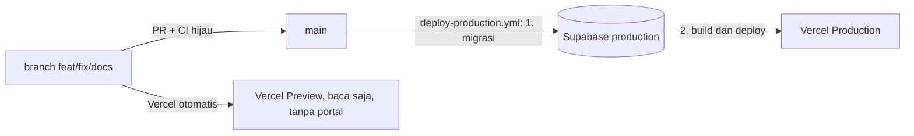

# CI/CD

Semua layanan memakai paket gratis (CLAUDE.md bagian 10). Dokumen ini menjelaskan alur, secret yang dibutuhkan, dan cara rollback.

## Alur

Tanpa staging (keputusan owner, Fase 2, mengikuti pola prins dan kelola). Setiap merge ke `main` langsung tayang.

1. Kerja di branch `feat/...`, `fix/...`, `chore/...`, `docs/...`, lalu buka PR ke `main`.
2. Workflow `ci.yml` dan `security.yml` jalan di setiap PR. Vercel membuat Preview, lalu `preview.yml` menjalankan smoke E2E dan Lighthouse. Preview hanya membaca konten publik dari Supabase production (publishable key, tanpa secret key). Portal di preview dimatikan `proxy.ts`, dan form publik tidak menulis, jadi tidak ada data percobaan yang masuk ke production.
3. Merge hanya lewat `bash scripts/merge-pr.sh <nomor>`. Skrip menolak kalau ada check yang belum hijau, check wajib tidak ada, branch tertinggal dari `main`, atau judul PR bukan Conventional Commits.
4. Setelah merge, `deploy-production.yml` menerapkan migrasi baru ke Supabase production, lalu build dan deploy Vercel production. Urutan ini wajib karena halaman website di-prerender dari database. Migrasi tetap wajib backward compatible (expand lalu contract), karena versi lama masih melayani pengunjung selama proses ini.
5. Akhir fase: pasang label `e2e:full` di PR terakhir fase, lalu push, supaya E2E jalan di 3 browser x 3 shard.

## Pengaman pengganti branch protection

GitHub Free untuk repo private tidak menyediakan branch protection, rulesets, dan Environments. Penggantinya:

| Aturan | Dijaga oleh |
|---|---|
| Tanpa push langsung ke `main` | Hook Husky `pre-push`, aturan `deny` di `.claude/settings.json` |
| Tanpa force push | Aturan `deny` di `.claude/settings.json` |
| Merge hanya kalau semua check hijau | `scripts/merge-pr.sh` dan `scripts/required-checks.txt` |
| Akun yang benar | `scripts/check-accounts.sh` di hook dan sebelum memakai CLI |

Pengaman ini bisa dilewati oleh orang yang sengaja memakai `git push --no-verify` atau tombol merge di web GitHub. Kalau tim bertambah, pertimbangkan GitHub Pro supaya branch protection aktif di server.

## Workflow

| File | Pemicu | Isi |
|---|---|---|
| `ci.yml` | PR dan push ke `main` | typecheck, lint, check:copy, format, unit test + coverage 80%, build, E2E (PR saja). PR biasa: Chromium di 1 runner. PR akhir fase berlabel `e2e:full`: 3 browser x 3 shard (label dibaca saat event, jadi pasang label lalu push). Keputusan owner, Fase 2 |
| `security.yml` | PR dan mingguan | gitleaks, `pnpm audit --audit-level high` |
| `preview.yml` | Deploy Preview Vercel berhasil | Smoke E2E Chromium dan Lighthouse ke URL preview, komentar skor ke PR. Pemicu `deployment_status` hanya dibaca dari branch default, jadi workflow ini aktif setelah Fase 1 masuk ke `main` |
| `db.yml` | PR yang menyentuh `supabase/` | Migrasi dari nol, test RLS, lint database (aktif Fase 2) |
| `deploy-production.yml` | Push ke `main` (kecuali dokumen saja) | Migrasi dan pengaturan Auth production kalau ada perubahan database, lalu `vercel build --prod` dan `vercel deploy --prebuilt --prod` |
| `release.yml` | Push ke `main` | release-please: versi, tag, CHANGELOG |
| `e2e-weekly.yml` | Minggu 22.00 WIB | Suite penuh 3 kali tanpa retry, issue otomatis kalau gagal |
| `keepalive.yml` | Harian 09.17 WIB | Ping API Supabase production supaya project tidak dijeda (Supabase Free menjeda setelah 7 hari tanpa aktivitas). Issue otomatis kalau gagal |

## Secret GitHub (repository secrets)

Diisi di GitHub, menu Settings, Secrets and variables, Actions. Tidak pernah di file repo.

| Secret | Dipakai | Status | Cara mendapatkan |
|---|---|---|---|
| `CRON_SECRET` | Fase 6 (worker cron) | Dibuat otomatis di Fase 1 | Acak, salinannya di `~/.config/kis/accounts.env` |
| `VERCEL_TOKEN`, `VERCEL_ORG_ID`, `VERCEL_PROJECT_ID` | `deploy-production.yml` | Ada | `.vercel/project.json` atau dashboard Vercel |
| `VERCEL_AUTOMATION_BYPASS_SECRET` | `preview.yml` | Perlu diisi owner | Vercel, project, Settings, Deployment Protection, Protection Bypass for Automation |
| `SUPABASE_ACCESS_TOKEN` | `deploy-production.yml` | Ada | supabase.com, Account, Access Tokens |
| `PRODUCTION_SUPABASE_PROJECT_REF`, `PRODUCTION_SUPABASE_DB_PASSWORD` | `deploy-production.yml` | Fase 2 | Ref `skxawyvopumzrefnmvyf`. Password dibuat acak lewat Management API, tidak ditampilkan |
| `PRODUCTION_SUPABASE_URL`, `PRODUCTION_SUPABASE_PUBLISHABLE_KEY` | `keepalive.yml` | Ada | URL dan publishable key project production |
| `SENTRY_AUTH_TOKEN` | Upload source map | Setelah akun Sentry dibuat | Sentry, Settings, Auth Tokens |

## Env Vercel

| Variabel | Production | Preview |
|---|---|---|
| `NEXT_PUBLIC_SITE_URL` | `https://kisg-web.vercel.app`, diganti `https://kisgroup.co.id` saat domain siap | Tidak diisi: otomatis memakai `NEXT_PUBLIC_VERCEL_URL` |
| `NEXT_PUBLIC_SENTRY_DSN` | Setelah akun Sentry ada | Sama |
| `ENABLE_DEV_UI` | Jangan diisi | Jangan diisi |

| `SUPABASE_URL`, `SUPABASE_PUBLISHABLE_KEY` | Project production | Sama (baca konten publik saja). Portal di preview 503 |
| `SUPABASE_SECRET_KEY` | Project production | Tidak diisi |

Variabel Meta, Brevo, Turnstile, dan Gemini ditambah di fase masing-masing.

## Rollback

- **App**: Vercel, project, Deployments, pilih deployment production sebelumnya, Instant Rollback. Di Vercel Hobby, rollback hanya ke deployment production sebelumnya.
- **Database**: buat migrasi perbaikan baru di branch fix, lewat PR seperti biasa. Migrasi lama tidak pernah diedit.
- **Data hilang**: tidak ada backup terjadwal (keputusan owner, Fase 2). Supabase Free juga tidak punya backup otomatis, jadi data yang terhapus tidak bisa dikembalikan. Kalau dibutuhkan lagi, workflow backup bisa dipasang ulang.

## Anggaran menit Actions

Lihat `docs/roadmap.md`. Pemakaian aktual dicatat di akhir setiap fase.
