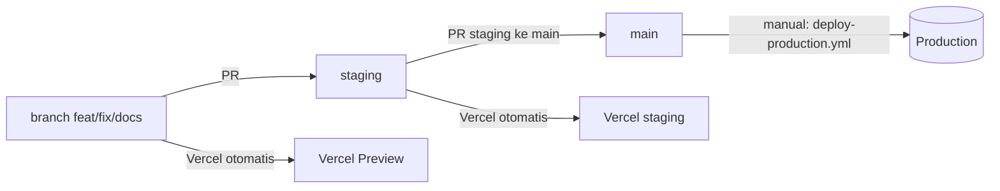

# CI/CD

Semua layanan memakai paket gratis (CLAUDE.md bagian 10). Dokumen ini menjelaskan alur, secret yang dibutuhkan, dan cara rollback.

## Alur

1. Kerja di branch `feat/...`, `fix/...`, `chore/...`, `docs/...`, lalu buka PR ke `staging`.
2. Workflow `ci.yml` dan `security.yml` jalan di setiap PR. Vercel membuat Preview, lalu `preview.yml` menjalankan smoke E2E dan Lighthouse.
3. Merge hanya lewat `bash scripts/merge-pr.sh <nomor>`. Skrip menolak kalau ada check yang belum hijau, check wajib tidak ada, branch tertinggal dari base, atau judul PR bukan Conventional Commits.
4. Setelah dicek di staging, buka PR `staging` ke `main`, lalu merge dengan skrip yang sama.
5. Deploy production: tab Actions, workflow **Deploy production**, tombol "Run workflow" dari `main`, ketik `production`. Workflow menjalankan migrasi database dulu, lalu build dan deploy Vercel production. Deploy otomatis Vercel dari `main` dimatikan di `vercel.json`.

## Pengaman pengganti branch protection

GitHub Free untuk repo private tidak menyediakan branch protection, rulesets, dan Environments. Penggantinya:

| Aturan | Dijaga oleh |
|---|---|
| Tanpa push langsung ke `main`/`staging` | Hook Husky `pre-push`, aturan `deny` di `.claude/settings.json` |
| Tanpa force push | Aturan `deny` di `.claude/settings.json` |
| Merge hanya kalau semua check hijau | `scripts/merge-pr.sh` dan `scripts/required-checks.txt` |
| Approval deploy production | `deploy-production.yml` manual dengan konfirmasi |
| Akun yang benar | `scripts/check-accounts.sh` di hook dan sebelum memakai CLI |

Pengaman ini bisa dilewati oleh orang yang sengaja memakai `git push --no-verify` atau tombol merge di web GitHub. Kalau tim bertambah, pertimbangkan GitHub Pro supaya branch protection aktif di server.

## Workflow

| File | Pemicu | Isi |
|---|---|---|
| `ci.yml` | PR dan push ke `staging`/`main` | typecheck, lint, check:copy, format, unit test + coverage 80%, build, E2E 3 shard x 3 browser (PR saja) |
| `security.yml` | PR dan mingguan | gitleaks, `pnpm audit --audit-level high` |
| `preview.yml` | Deploy Preview Vercel berhasil | Smoke E2E Chromium dan Lighthouse ke URL preview, komentar skor ke PR. Pemicu `deployment_status` hanya dibaca dari branch default, jadi workflow ini aktif setelah Fase 1 masuk ke `main` |
| `db.yml` | PR yang menyentuh `supabase/` | Migrasi dari nol, test RLS, lint database (aktif Fase 2) |
| `deploy-db.yml` | Push ke `staging` yang menyentuh migrasi | `supabase db push` ke staging (aktif Fase 2) |
| `deploy-production.yml` | Manual | Migrasi production lalu deploy Vercel production |
| `release.yml` | Push ke `main` | release-please: versi, tag, CHANGELOG |
| `e2e-weekly.yml` | Minggu 22.00 WIB | Suite penuh 3 kali tanpa retry, issue otomatis kalau gagal |
| `backup.yml` | Harian 02.00 WIB | `pg_dump` production terenkripsi (artifact 30 hari), ping staging |

## Secret GitHub (repository secrets)

Diisi di GitHub, menu Settings, Secrets and variables, Actions. Tidak pernah di file repo.

| Secret | Dipakai | Status | Cara mendapatkan |
|---|---|---|---|
| `CRON_SECRET` | Fase 6 (worker cron) | Dibuat otomatis di Fase 1 | Acak, salinannya di `~/.config/kis/accounts.env` |
| `BACKUP_PASSPHRASE` | `backup.yml` | Dibuat otomatis di Fase 1 | Acak, salinannya di `~/.config/kis/accounts.env`. Wajib untuk membuka backup |
| `VERCEL_TOKEN` | `deploy-production.yml` | Perlu diisi owner | vercel.com, Account Settings, Tokens. Scope tim `kisg-project` |
| `VERCEL_ORG_ID`, `VERCEL_PROJECT_ID` | `deploy-production.yml` | Diisi setelah project Vercel dibuat | `.vercel/project.json` atau dashboard Vercel |
| `VERCEL_AUTOMATION_BYPASS_SECRET` | `preview.yml` | Perlu diisi owner | Vercel, project, Settings, Deployment Protection, Protection Bypass for Automation |
| `SUPABASE_ACCESS_TOKEN` | `deploy-db.yml`, `deploy-production.yml` | Fase 2 | supabase.com, Account, Access Tokens |
| `STAGING_SUPABASE_PROJECT_REF`, `STAGING_SUPABASE_DB_PASSWORD` | `deploy-db.yml` | Fase 2 | Ref `zpxdkjmwsjeeeypszwzm`, password ada di `accounts.env` (`KIS_STAGING_DB_PASSWORD`) |
| `PRODUCTION_SUPABASE_PROJECT_REF`, `PRODUCTION_SUPABASE_DB_PASSWORD` | `deploy-production.yml` | Fase 2 | Ref `skxawyvopumzrefnmvyf`, password dipegang owner |
| `PRODUCTION_SUPABASE_DB_URL` | `backup.yml` | Fase 2 | Supabase, project production, Connect, connection string |
| `STAGING_SUPABASE_URL`, `STAGING_SUPABASE_ANON_KEY` | `backup.yml` (ping) | Fase 2 | Supabase, project staging, API settings |
| `SENTRY_AUTH_TOKEN` | Upload source map | Setelah akun Sentry dibuat | Sentry, Settings, Auth Tokens |

## Env Vercel

| Variabel | Production | Preview (termasuk staging) |
|---|---|---|
| `NEXT_PUBLIC_SITE_URL` | `https://kisgroup.co.id` (diisi saat domain siap) | Tidak diisi: otomatis memakai `NEXT_PUBLIC_VERCEL_URL` |
| `NEXT_PUBLIC_SENTRY_DSN` | Setelah akun Sentry ada | Sama |
| `ENABLE_DEV_UI` | Jangan diisi | Jangan diisi |

Variabel Supabase, Meta, Resend, Turnstile, dan Gemini ditambah di fase masing-masing.

## Rollback

- **App**: Vercel, project, Deployments, pilih deployment production sebelumnya, Instant Rollback. Di Vercel Hobby, rollback hanya ke deployment production sebelumnya.
- **Database**: buat migrasi perbaikan baru di branch fix, lewat PR seperti biasa. Migrasi lama tidak pernah diedit.
- **Data hilang**: unduh artifact `backup-production` dari run `backup.yml`, lalu buka dengan `gpg --decrypt backup-*.tar.gz.gpg > backup.tar.gz` memakai `BACKUP_PASSPHRASE`. Langkah restore dicoba di staging di Fase 9 dan dicatat di sini.

## Anggaran menit Actions

Lihat `docs/roadmap.md`. Pemakaian aktual dicatat di akhir setiap fase.
