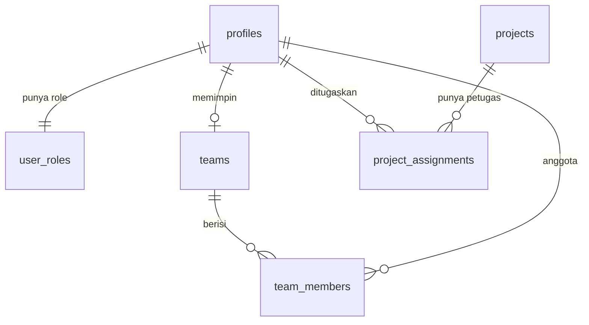
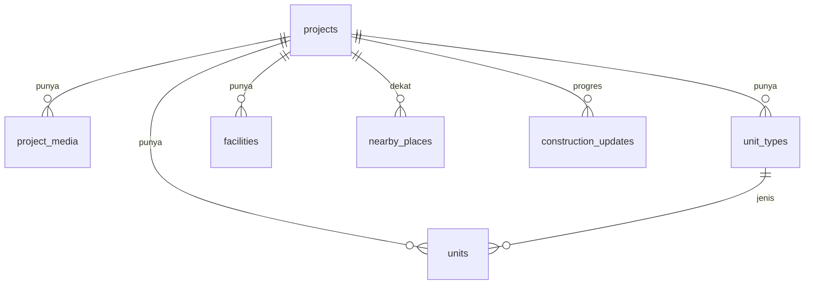
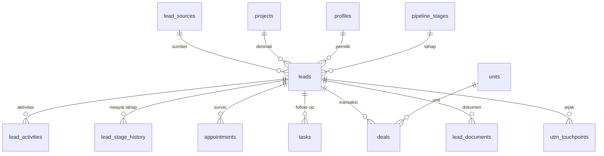
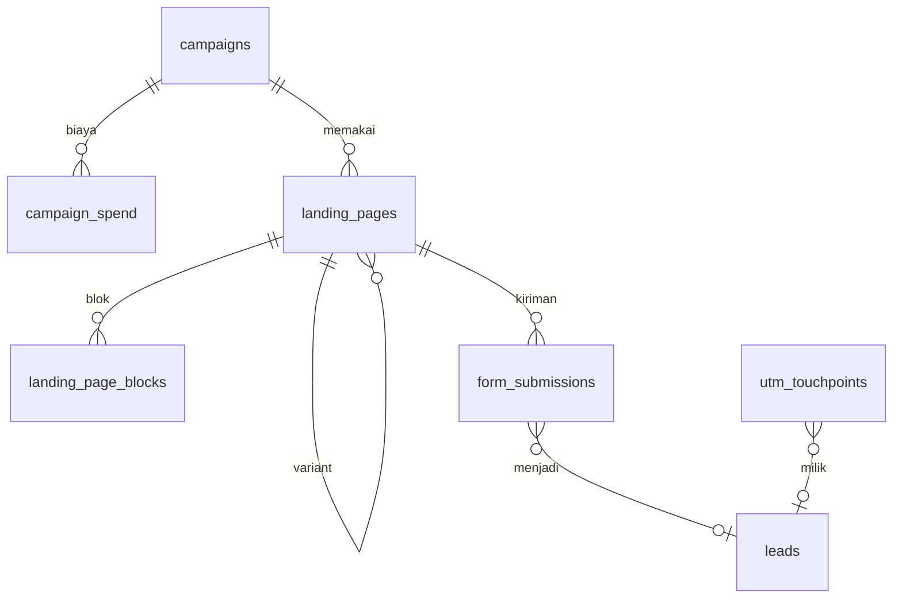
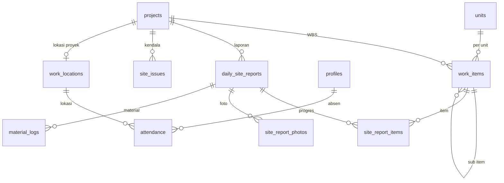

# Model data KIS Group Platform

Disusun di Fase 0, diimplementasikan sebagai migrasi di Fase 2 (dan fase fitur terkait). Nama tabel dan kolom bahasa Inggris snake_case. Nilai enum bahasa Indonesia supaya sama dengan istilah bisnis dan `src/config/`.

## 1. Konvensi

- Primary key `id uuid default gen_random_uuid()`, kecuali disebut lain.
- Kolom standar di setiap tabel bisnis (tidak ditulis ulang di daftar bawah): `created_at timestamptz default now()`, `updated_at timestamptz` (trigger), `created_by uuid references profiles`, `deleted_at timestamptz` (soft delete). Tabel log (`audit_log`, `*_history`, `rate_limits`, outbox, webhook) tidak memakai soft delete.
- Waktu: selalu `timestamptz` (UTC). Tanggal kalender lokal (misal tanggal laporan) memakai `date` yang dihitung di zona `Asia/Jakarta`.
- Uang: `bigint` rupiah. Luas: `numeric(8,2)` m2. Persen: `numeric(5,2)`.
- Nomor HP: `text` E.164 (`+62...`), dinormalisasi trigger `normalize_phone()` sebelum insert/update.
- Baris yang dibuat dari portal (bisa offline) punya `client_id uuid unique` sebagai idempotency key.
- Query aktif selalu menyaring `deleted_at is null`. Unique index bisnis dibuat parsial `where deleted_at is null`.
- RLS aktif di semua tabel `public`. Fungsi helper di schema `private` (lihat `docs/architecture.md` bagian 4).

## 2. Enum

| Enum | Nilai |
|---|---|
| `app_role` | owner, admin, marketing_manager, marketing, site_manager, site_supervisor, finance |
| `project_status` | segera, tersedia, sold_out |
| `unit_status` | tersedia, hold, booking, terjual |
| `content_status` | draft, terjadwal, terbit, arsip |
| `media_kind` | foto, video, siteplan, denah, brosur |
| `lead_stage` | baru, dihubungi, prospek, jadwal_survei, sudah_survei, negosiasi, booking_fee, proses_berkas, akad, batal |
| `lead_source_kind` | website, landing_page, meta_lead_ads, chat, manual, walk_in, instagram, whatsapp, referral |
| `lead_activity_type` | telepon, whatsapp, email, survei, pertemuan, catatan, perubahan_tahap, dokumen, sistem |
| `appointment_status` | dijadwalkan, selesai, batal, tidak_hadir |
| `task_status` | terbuka, selesai, batal |
| `deal_status` | booking_fee, proses_berkas, akad, batal |
| `payment_method` | tunai_keras, tunai_bertahap, kpr |
| `lead_document_kind` | ktp, kk, npwp, slip_gaji, rekening_koran, surat_nikah, lainnya |
| `form_kind` | minat, kontak, brosur, landing_page, karir, chat |
| `submission_status` | diterima, ditolak_validasi, ditolak_honeypot, ditolak_rate_limit, ditolak_turnstile |
| `lp_block_type` | hero, keunggulan, tipe_unit, galeri, lokasi, simulasi_kpr, promo, faq, form_lead, cta_wa |
| `outbox_status` | pending, processing, sent, failed, dead, expired |
| `webhook_status` | diterima, diproses, gagal, duplikat |
| `report_status` | draft, diajukan, disetujui, dikembalikan |
| `weather` | cerah, berawan, hujan_ringan, hujan_lebat |
| `issue_priority` | rendah, sedang, tinggi, kritis |
| `issue_status` | terbuka, ditangani, selesai |
| `attendance_kind` | masuk, pulang |
| `attendance_status` | valid, di_luar_radius, disetujui, ditolak, perlu_tinjau |
| `marketing_activity_type` | follow_up, survei, canvassing, open_table, konten, lainnya |
| `kpi_period` | mingguan, bulanan |
| `application_status` | baru, diproses, wawancara, diterima, ditolak |
| `chat_session_status` | bot, menunggu_cs, ditangani_cs, selesai |
| `chat_role` | pengunjung, asisten, marketing, sistem, tool |
| `pdp_request_kind` | ekspor, hapus |
| `pdp_request_status` | diterima, diproses, selesai, ditolak |
| `audit_action` | insert, update, delete, soft_delete |

Enum yang sama ada di `src/config/` (`roles.ts`, `pipeline.ts`, `units.ts`). Test unit memastikan keduanya sama dengan `database.types.ts`.

## 3. Inti dan akses

| Tabel | Kolom utama | Index dan constraint |
|---|---|---|
| `profiles` | `id` (= `auth.users.id`), `full_name`, `phone`, `avatar_path`, `is_active bool`, `last_seen_at` | |
| `user_roles` | `user_id` PK, `role app_role` | satu role per user |
| `teams` | `name`, `kind` (marketing, lapangan), `leader_id` | unique `name` |
| `team_members` | `team_id`, `user_id`, `receives_leads bool`, `lead_project_ids uuid[]` (kosong = semua proyek) | PK (`team_id`, `user_id`), satu tim aktif per user |
| `project_assignments` | `project_id`, `user_id`, `role_on_project` (supervisor, manager, marketing) | unique (`project_id`, `user_id`) |

## 4. Properti

| Tabel | Kolom utama | Index dan constraint |
|---|---|---|
| `projects` | `slug`, `name`, `status project_status`, `content_status`, `tagline`, `description`, `address`, `village`, `district`, `city`, `province`, `lat`, `lng`, `geofence_radius_m int`, `siteplan_svg_path`, `legal_summary jsonb` (SHM/PBG per tahap), `launched_on`, `sold_out_on`, `is_featured`, `sort_order` | unique `slug`, index `status` |
| `project_media` | `project_id`, `kind media_kind`, `path`, `alt` (wajib), `caption`, `width`, `height`, `sort_order` | index (`project_id`, `sort_order`) |
| `unit_types` | `project_id`, `slug`, `name`, `land_area`, `building_area`, `bedrooms`, `bathrooms`, `floors`, `specs jsonb`, `price_from bigint null`, `show_price bool`, `floor_plan_path`, `sort_order` | unique (`project_id`, `slug`) |
| `units` | `project_id`, `unit_type_id`, `block`, `number`, `code` (misal A-12), `land_area`, `building_area`, `price bigint null`, `status unit_status`, `hold_expires_at`, `held_by`, `siteplan_shape_id` (id elemen di SVG), `is_corner bool`, `facing` | unique (`project_id`, `code`), index (`project_id`, `status`) |
| `facilities` | `project_id`, `name`, `icon` (nama ikon lucide yang diizinkan), `description`, `sort_order` | |
| `nearby_places` | `project_id`, `name`, `category`, `distance_km numeric(6,2)`, `travel_minutes int`, `travel_mode` | |
| `construction_updates` | `project_id`, `title`, `body`, `photo_ids uuid[]` (dari `site_report_photos`), `source_report_id`, `content_status`, `published_at` | index (`project_id`, `published_at desc`) |

Perubahan status unit hanya lewat fungsi `book_unit()`, `hold_unit()`, `release_unit()` (transaksi + `select ... for update`). Supaya satu unit tidak bisa dibooking dua orang, ada partial unique index di `deals (unit_id) where status <> 'batal'`.

## 5. CRM

| Tabel | Kolom utama | Index dan constraint |
|---|---|---|
| `lead_sources` | `kind lead_source_kind`, `name` (misal "Meta Lead Ads: Form Promo Desember"), `is_active` | unique (`kind`, `name`) |
| `pipeline_stages` | `key lead_stage` PK, `label`, `sort_order`, `is_active`, `sla_hours int null`, `meta_event_name text null`, `is_won bool`, `is_lost bool` | label dan urutan bisa diatur admin, kunci tetap enum |
| `leads` | `full_name`, `phone`, `email`, `project_id`, `unit_type_id`, `source_id`, `source_kind`, `stage lead_stage`, `owner_id`, `team_id`, `meta_lead_id`, `chat_session_id`, `consent_pdp_at`, `consent_text_version`, `fbp`, `fbc`, `lp_variant_id`, `first_response_at`, `sla_due_at`, `last_activity_at`, `lost_reason`, `merged_into_id` | partial unique `phone where deleted_at is null and merged_into_id is null`, unique `meta_lead_id`, index (`owner_id`, `stage`), (`team_id`, `stage`), (`project_id`, `created_at`) |
| `lead_activities` | `lead_id`, `actor_id`, `type lead_activity_type`, `body`, `occurred_at`, `meta jsonb`, `client_id` | index (`lead_id`, `occurred_at desc`) |
| `lead_stage_history` | `lead_id`, `from_stage`, `to_stage`, `changed_by`, `changed_at` | index (`lead_id`, `changed_at`) |
| `appointments` | `lead_id`, `project_id`, `assigned_to`, `scheduled_at`, `status appointment_status`, `result_note` | index (`assigned_to`, `scheduled_at`) |
| `tasks` | `lead_id`, `assignee_id`, `title`, `due_at`, `status task_status`, `completed_at` | index (`assignee_id`, `status`, `due_at`) |
| `deals` | `lead_id`, `unit_id`, `status deal_status`, `agreed_price bigint`, `booking_fee bigint`, `payment_method`, `booked_at`, `akad_at`, `cancelled_at`, `cancel_reason` | partial unique (`unit_id`) `where status <> 'batal'` |
| `lead_documents` | `lead_id`, `kind lead_document_kind`, `path` (bucket `customer-docs`), `uploaded_by` | index `lead_id` |
| `lead_assignment_state` | `scope_key` PK (`global`, keputusan owner: semua marketing bergiliran untuk semua proyek. Kunci per proyek disiapkan kalau aturan berubah), `last_user_id`, `updated_at` | dipakai fungsi `assign_lead_round_robin()` dengan `for update` |

Trigger:
- `leads` sebelum insert: normalisasi nomor. Kalau nomor sudah ada, data digabung ke lead lama (aktivitas "lead masuk lagi"), lalu insert dibatalkan lewat fungsi `upsert_lead()`. Insert langsung tidak dipakai.
- `leads` setelah update `stage`: tulis `lead_stage_history`.
- `lead_stage_history` setelah insert: tulis `meta_event_outbox` kalau `pipeline_stages.meta_event_name` terisi.

## 6. Marketing, kampanye, landing page

| Tabel | Kolom utama | Index dan constraint |
|---|---|---|
| `campaigns` | `name`, `platform` (meta, google, offline, lainnya), `project_id`, `meta_campaign_id`, `starts_on`, `ends_on`, `is_active` | |
| `campaign_spend` | `campaign_id`, `spend_date date`, `amount bigint` | unique (`campaign_id`, `spend_date`) |
| `landing_pages` | `slug`, `title`, `project_id`, `campaign_id`, `content_status`, `variant_of uuid null`, `variant_key`, `traffic_weight int`, `chat_enabled bool`, `seo jsonb` | unique `slug where variant_of is null`, unique (`variant_of`, `variant_key`) |
| `landing_page_blocks` | `landing_page_id`, `type lp_block_type`, `sort_order`, `is_visible`, `content jsonb` (divalidasi schema Zod per tipe) | index (`landing_page_id`, `sort_order`) |
| `form_submissions` | `form_kind`, `page_path`, `landing_page_id`, `lead_id`, `status submission_status`, `ip_hash`, `user_agent`, `payload jsonb` (tanpa data sensitif) | index (`form_kind`, `created_at`) |
| `utm_touchpoints` | `visitor_id` (cookie first-party), `lead_id`, `utm_source`, `utm_medium`, `utm_campaign`, `utm_content`, `utm_term`, `fbclid`, `fbp`, `fbc`, `referrer`, `landing_path`, `lp_variant_id`, `occurred_at` | index `visitor_id`, `lead_id` |

## 7. Meta

| Tabel | Kolom utama | Index dan constraint |
|---|---|---|
| `meta_event_outbox` | `event_id uuid`, `event_name`, `origin` (website, crm, chat), `lead_id`, `event_time`, `payload jsonb` (sudah ter-hash), `status outbox_status`, `attempts`, `next_attempt_at`, `last_response jsonb`, `sent_at` | unique `event_id`, index (`status`, `next_attempt_at`) |
| `meta_webhook_events` | `leadgen_id`, `page_id`, `form_id`, `payload jsonb`, `status webhook_status`, `attempts`, `error`, `lead_id`, `received_at`, `processed_at` | unique `leadgen_id` |

## 8. Lapangan dan absensi

Absensi dipakai tim lapangan dan tim marketing (keputusan owner Fase 0). Marketing absen di kantor atau di lokasi proyek. Kegiatan di luar lokasi (canvassing, open table) dicatat sebagai absensi di luar radius dengan alasan, lalu ditinjau manager.

| Tabel | Kolom utama | Index dan constraint |
|---|---|---|
| `work_items` | `project_id`, `unit_id null`, `parent_id null`, `code`, `name`, `weight numeric(6,3)` (bobot terhadap unit), `planned_start`, `planned_end`, `sort_order` | unique (`project_id`, `unit_id`, `code`) |
| `daily_site_reports` | `project_id`, `author_id`, `report_date date`, `status report_status`, `weather`, `workers jsonb` (jumlah per keahlian), `notes`, `submitted_at`, `reviewed_by`, `reviewed_at`, `review_note`, `client_id` | unique (`project_id`, `author_id`, `report_date`), index (`project_id`, `status`) |
| `site_report_items` | `report_id`, `work_item_id`, `progress_percent` (kumulatif), `note` | unique (`report_id`, `work_item_id`) |
| `site_report_photos` | `report_id`, `report_item_id null`, `path` (bucket `site-reports`), `taken_at`, `lat`, `lng`, `caption`, `is_public_candidate bool` | index `report_id` |
| `material_logs` | `report_id`, `project_id`, `material_name`, `unit_label` (sak, m3, batang), `qty_in`, `qty_used`, `note` | index (`project_id`, `created_at`) |
| `site_issues` | `project_id`, `report_id null`, `title`, `description`, `priority`, `status`, `reported_by`, `assigned_to`, `photo_path`, `resolved_at` | index (`project_id`, `status`) |
| `work_locations` | `name`, `kind` (kantor, proyek), `project_id null`, `lat`, `lng`, `radius_m int`, `is_active` | titik geofence absensi: kantor pemasaran dan lokasi proyek |
| `attendance` | `user_id`, `work_location_id`, `project_id null`, `kind attendance_kind`, `captured_at`, `received_at`, `lat`, `lng`, `accuracy_m`, `distance_m`, `within_geofence bool`, `selfie_path` (bucket `attendance`), `status attendance_status`, `justification`, `reviewed_by`, `client_id` | index (`user_id`, `captured_at`), unique `client_id` |

Progres fisik unit = jumlah (`weight` x progres terakhir yang disetujui) per item. Dihitung lewat view `unit_progress` dan materialized view `project_progress`, disegarkan saat laporan disetujui.

## 9. Kinerja (marketing dan KPI)

| Tabel | Kolom utama | Index dan constraint |
|---|---|---|
| `marketing_activities` | `user_id`, `type marketing_activity_type`, `occurred_at`, `project_id`, `lead_id null`, `lead_activity_id null`, `location_note`, `photo_path`, `note`, `client_id` | unique `lead_activity_id` (aktivitas CRM otomatis tercermin, tidak diinput dua kali) |
| `kpi_definitions` | `key`, `name`, `role app_role`, `metric_key` (nama fungsi SQL penghitung), `weight numeric(5,2)`, `higher_is_better bool`, `is_active` | unique `key` |
| `kpi_targets` | `definition_id`, `user_id null`, `team_id null`, `period kpi_period`, `period_start`, `target_value numeric` | unique (`definition_id`, `user_id`, `team_id`, `period_start`) |
| `kpi_scores` | `definition_id`, `user_id`, `period_start`, `actual_value`, `score numeric(5,2)`, `computed_at` | unique (`definition_id`, `user_id`, `period_start`) |

## 10. Konten website (CMS)

| Tabel | Kolom utama | Index dan constraint |
|---|---|---|
| `posts` | `slug`, `title`, `excerpt`, `body jsonb` (dokumen rich text, disanitasi saat render), `cover_path`, `cover_alt`, `content_status`, `scheduled_at`, `published_at`, `author_id` | unique `slug`, index (`content_status`, `published_at desc`) |
| `promos` | `slug`, `title`, `summary`, `body jsonb`, `terms`, `project_id`, `cover_path`, `cover_alt`, `starts_at`, `ends_at`, `content_status` | unique `slug`, index (`ends_at`) |
| `banners` | `title`, `subtitle`, `image_path`, `mobile_image_path`, `alt`, `cta_label`, `cta_href`, `starts_at`, `ends_at`, `sort_order`, `content_status` | |
| `testimonials` | `name`, `project_id`, `quote`, `photo_path`, `consent_at` (wajib terisi untuk terbit), `content_status`, `sort_order` | check: terbit hanya kalau `consent_at` terisi |
| `faqs` | `question`, `answer`, `category`, `project_id null`, `sort_order`, `content_status` | |
| `careers` | `slug`, `title`, `department`, `location`, `employment_type`, `description jsonb`, `requirements jsonb`, `closes_on`, `content_status` | unique `slug` |
| `job_applications` | `career_id`, `full_name`, `phone`, `email`, `cv_path` (bucket `job-applications`), `cover_note`, `status application_status`, `consent_pdp_at` | index (`career_id`, `status`) |
| `site_settings` | `key` PK, `value jsonb`, `is_public bool` | kontak, statistik beranda, jam operasional, alamat |
| `seo_meta` | `path` unique, `title`, `description`, `og_image_path`, `noindex bool` | |

## 11. Chat dan knowledge base

| Tabel | Kolom utama | Index dan constraint |
|---|---|---|
| `chat_sessions` | `visitor_user_id` (user anonim Supabase), `page_path`, `landing_page_id`, `status chat_session_status`, `assigned_to`, `lead_id`, `started_at`, `last_message_at`, `handoff_at`, `closed_at`, `tokens_in`, `tokens_out`, `cost_micro_usd bigint`, `summary` | index (`status`, `last_message_at`), index `visitor_user_id` |
| `chat_messages` | `session_id`, `role chat_role`, `content`, `tool_name`, `tool_payload jsonb`, `tokens int`, `flagged_wrong bool`, `flagged_by`, `is_unanswered bool` | index (`session_id`, `created_at`) |
| `cs_knowledge` | `title`, `content`, `project_id null`, `embedding vector(N)`, `embedding_model`, `embedded_at`, `is_active` | index HNSW `embedding vector_cosine_ops`. Dimensi `N` ditetapkan di Fase 7 sesuai model embedding |
| `cs_settings` | `id` (satu baris), `working_hours jsonb` (per hari, WIB), `greeting`, `suggestions text[]`, `daily_cost_limit_micro_usd bigint`, `max_messages_per_session int`, `max_message_chars int`, `retention_days int` | check satu baris |

## 12. Sistem

| Tabel | Kolom utama | Index dan constraint |
|---|---|---|
| `notifications` | `user_id`, `type`, `title`, `body`, `href`, `read_at` | index (`user_id`, `read_at`, `created_at desc`) |
| `push_subscriptions` | `user_id`, `endpoint`, `p256dh`, `auth`, `user_agent`, `last_used_at` | unique `endpoint` |
| `audit_log` | `id bigint identity`, `table_name`, `row_id`, `action audit_action`, `actor_id`, `old_data jsonb`, `new_data jsonb`, `at` | index (`table_name`, `row_id`), (`actor_id`, `at`). Hanya insert lewat trigger |
| `rate_limits` | `key` (misal `form:ip_hash`), `window_start`, `count` | PK (`key`, `window_start`), tabel unlogged, dibersihkan job retensi |
| `pdp_requests` | `subject_phone`, `subject_email`, `kind pdp_request_kind`, `status`, `requested_at`, `completed_at`, `handled_by`, `result_path` | |

Audit trigger terpasang di: `leads`, `deals`, `units`, `user_roles`, `profiles`, `projects`, `unit_types`, `posts`, `promos`, `banners`, `testimonials`, `faqs`, `careers`, `landing_pages`, `landing_page_blocks`, `site_settings`, `pipeline_stages`, `kpi_definitions`, `cs_knowledge`, `cs_settings`.

## 13. Ringkasan RLS per role

Keterangan:
- **S**: semua baris
- **M**: miliknya sendiri
- **T**: milik anggota timnya
- **P**: proyek yang ditugaskan
- **Pub**: hanya yang terbit atau aktif
- **R**: baca
- **W**: tulis (insert/update)
- **-**: ditolak

| Data | anon (publik) | owner | admin | marketing_manager | marketing | site_manager | site_supervisor | finance |
|---|---|---|---|---|---|---|---|---|
| Proyek, tipe unit, media, fasilitas, tempat terdekat | R Pub | RW S | RW S | R S | R S | R S | R P | R S |
| Units | R Pub (kolom publik, termasuk status) | RW S | RW S | R S, W status lewat fungsi booking | R S, W status lewat fungsi booking | R S | R P | R S |
| Konten CMS (posts, promos, banners, testimonials, faqs, careers, seo_meta) | R Pub | RW S | RW S | - | - | - | - | - |
| `site_settings` | R `is_public` | RW S | RW S | R | R | R | R | R |
| `job_applications` | W insert saja (lewat server action) | R S | RW S | - | - | - | - | - |
| Leads, aktivitas, riwayat tahap, appointments, tasks | - (insert hanya lewat server action/webhook dengan service role) | RW S | RW S | RW T | RW M | - | - | R S (lead tahap booking_fee ke atas) |
| Deals | - | RW S | RW S | RW T | RW M | - | - | R S |
| `lead_documents` | - | R S | RW S | R T | RW M | - | - | R S |
| Kampanye, biaya iklan, landing pages | R Pub (landing page terbit) | RW S | RW S | R S | R S | - | - | R S |
| `form_submissions`, `utm_touchpoints` | - | R S | R S | R T (lewat lead) | R M (lewat lead) | - | - | - |
| Meta outbox dan webhook | - | R S | RW S (kirim ulang) | - | - | - | - | - |
| `work_items` | - | R S | RW S | - | - | RW P | R P | - |
| Laporan harian, item, foto, material | - | R S | R S | - | - | R P, W review | RW M (status draft/dikembalikan) di P | - |
| `site_issues` | - | R S | R S | - | - | RW P | RW P | - |
| `construction_updates` | R Pub | RW S | RW S | - | - | RW P | - | - |
| `attendance` | - | R S | R S | R T, W review timnya | RW M (insert) | R P, W review | RW M (insert) | - |
| `work_locations` | - | RW S | RW S | R | R | R | R | - |
| `marketing_activities` | - | R S | R S | R T | RW M | - | - | - |
| KPI definisi dan target | - | RW S | RW S | R S, W target timnya | R M | R S, W target timnya | R M | - |
| `kpi_scores` | - | R S | R S | R T | R M | R T | R M | - |
| `chat_sessions`, `chat_messages` | RW M (sesi anonim sendiri) | R S | R S | RW yang ditugaskan dan antrean | RW yang ditugaskan dan antrean | - | - | - |
| `cs_knowledge`, `cs_settings` | - | RW S | RW S | - | - | - | - | - |
| Profil, role, tim, penugasan | - | RW S | RW S | R timnya | R M | R P | R M | R M |
| `notifications`, `push_subscriptions` | - | RW M | RW M | RW M | RW M | RW M | RW M | RW M |
| `audit_log` | - | R S | R S | - | - | - | - | - |
| `pdp_requests` | - | RW S | RW S | - | - | - | - | - |

Semua role staf mensyaratkan `is_active = true`. Penulisan yang melibatkan beberapa tabel (booking unit, upsert lead, persetujuan laporan) lewat fungsi `security definer` yang memeriksa role di dalamnya, bukan lewat policy tulis langsung.

## 14. Storage

| Bucket | Publik | Isi | Batas | Policy |
|---|---|---|---|---|
| `public-assets` | Ya | Foto proyek, berita, promo, banner, logo | 2 MB, gambar | Tulis: owner, admin |
| `site-reports` | Tidak | Foto laporan lapangan | 1 MB, gambar | Tulis: pembuat laporan di folder `user_id`-nya. Baca: P dan owner/admin |
| `attendance` | Tidak | Selfie absensi | 512 KB, gambar | Tulis: user sendiri. Baca: user sendiri, site_manager P, marketing_manager untuk timnya, owner/admin |
| `customer-docs` | Tidak | KTP, slip gaji, dsb | 2 MB, gambar dan PDF | Tulis dan baca mengikuti RLS `leads` |
| `job-applications` | Tidak | CV pelamar | 2 MB, PDF | Tulis: server action. Baca: owner, admin |
| `avatars` | Tidak | Foto profil staf | 256 KB, gambar | Tulis: user sendiri. Baca: staf |

Batas ukuran di atas adalah batas keras server. Target kompresi client lebih kecil (CLAUDE.md bagian 8).

## 15. Fungsi dan job database

| Nama | Jenis | Fungsi |
|---|---|---|
| `custom_access_token_hook` | Auth hook | Menyuntikkan `app_role`, `team_id`, `is_active` |
| `normalize_phone` | Trigger | Nomor HP ke E.164 |
| `set_updated_at` | Trigger | `updated_at` |
| `audit_row` | Trigger | Menulis `audit_log` |
| `upsert_lead` | RPC security definer | Dedup nomor, gabung riwayat, round-robin, outbox Lead |
| `assign_lead_round_robin` | Fungsi | Memilih marketing berikutnya per proyek atau global |
| `record_stage_change`, `enqueue_conversion_event` | Trigger | Riwayat tahap dan outbox Conversion Leads |
| `hold_unit`, `book_unit`, `release_unit` | RPC | Status unit dengan penguncian baris |
| `expire_unit_holds` | pg_cron 5 menit | Hold lewat batas kembali ke tersedia |
| `claim_outbox_batch` | RPC | Ambil batch outbox dengan `skip locked` |
| `compute_kpi_scores` | pg_cron harian | Hitung skor KPI periode berjalan |
| `rate_limit_hit` | RPC | Penghitung rate limit |
| `match_cs_knowledge` | RPC | Pencarian vektor knowledge base |
